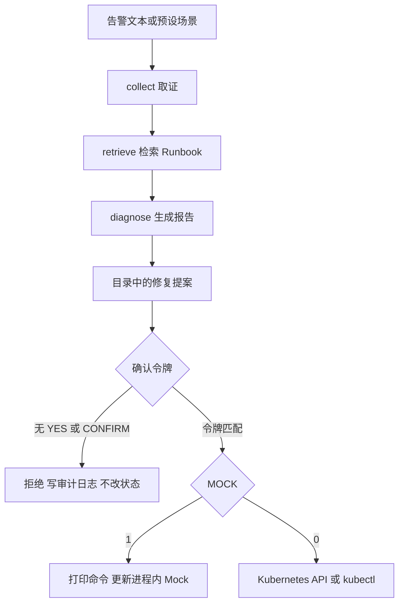
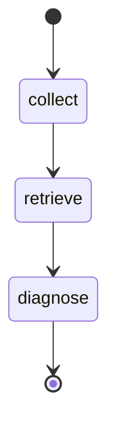

# K8s 故障诊断 SRE Agent 技术文档

| 项 | 内容 |
|---|---|
| 作品 | K8s 故障诊断 SRE Agent |
| 作者 / 学校 | （导出 PDF 前填写） |
| 推荐赛道 | 第九届传智杯 · AI大模型创新应用挑战赛 |
| 代码 | https://github.com/wangqi040318-gif/k8s-sre-agent |
| 在线演示 | （部署后填写，步骤见 `docs/在线演示部署.md`） |
| 文档状态 | 仓库内 Markdown 草稿。导出 PDF 时控制在 30 页以内 |

本文描述仓库里已经实现的行为。数字只在能从代码或 Mock 数据直接读到时出现，例如内存限制 `64Mi`、`256Mi`，退出码 137。不写未测量的准确率、时延或召回率。测试部分说明套件覆盖哪些行为；通过条数以提交者本地的 `pytest -q` 为准，正文不摘抄某一次运行的计数。

导出建议：A4，正文用小四或五号，保留标题层级。Mermaid 图需要编辑器支持（Typora、支持 Mermaid 的 VS Code 插件，或先导出成图片再贴回）。若工具不渲染图，正文里的节点名称已经足够复现结构，不要为了凑页数加实验表。

## 1. 摘要

作品是一条面向 Kubernetes 告警分诊的 Agent 流水线。输入是预设场景或一段告警文本，输出是中文诊断报告和一组修复提案。流水线固定为三段：向集群或 Mock 数据取证，用本地 TF-IDF 检索 Runbook，再由大模型或规则模板生成报告。

修复不在诊断图里。报告中的 `remediation` 来自动作目录。只有命令行传入大写 `YES`，或在提示中原样输入 `CONFIRM`，程序才执行。默认 `MOCK=1`：确认后的执行只打印命令并修改进程内的假状态。`MOCK=0` 且确认通过后，才通过 Kubernetes API 或参数形式的 kubectl 修改演示工作负载。

这样拆开，是为了让评委在没有集群、没有 API Key 的环境里看完「证据 → 知识 → 提案 → 人工闸门」，同时避免模型直接改集群。

## 2. 背景

Pod 不就绪的告警本身很少等于根因。ImagePullBackOff、OOMKilled、CrashLoopBackOff 三类故障的证据分别落在容器状态、Events、上次退出码和日志里，处置步骤又写在不同的 Runbook 中。人工值班的前几分钟主要花在把这些材料对齐。

把对话模型直接接到 kubeconfig 上会带来另一类问题：模型可以生成看起来合理的 `kubectl delete` 或 `kubectl set`，但生成不等于已经核对过镜像名、资源限制和所有者。教学演示若跳过确认，评委无法区分「程序会建议」和「程序已经改了集群」。

本作品把这个问题收成一个小闭环，服务对象是正在学习云原生排障的人，以及需要在作品集里说明 SRE 基本功的人。它不是集群的控制平面，也不替代变更审批系统。

## 3. 目标与非目标

目标：

- 无集群时，用三套固定证据复现 ImagePull、OOM、CrashLoop 的诊断报告。
- 报告包含现象、根因、证据、命中的 Runbook、风险，以及需人工确认的修复提案。
- 有 API Key 时走兼容 OpenAI 的聊天接口；没有 Key 时规则模板仍能出报告。
- 检索不依赖外网和向量数据库。
- 未确认的修复一定被拒绝，并留下审计日志。
- 提供 CLI 和 Streamlit 两种入口，执行函数只有一个。

非目标：

- 不自动修复，不在诊断图中加入 apply 节点。
- 不覆盖全部 Kubernetes 故障，只做三套演示动作。
- 不把上调内存限制或替换为休眠命令描述成生产环境的完整修复。
- 不提供多租户、审批流、工单系统或指标看板。
- 不在文档中承诺检测率。

## 4. 赛道说明

推荐提交到 **AI大模型创新应用挑战赛**。作品使用 Agent 编排和大模型（可选）完成一次完整的分诊，而不是只在网页里嵌入聊天窗口。规则回退保证没有 Key 时演示仍然成立；有 Key 时模型只负责组织报告，修复动作仍由目录生成。

**AI创新应用挑战赛** 使用同一套代码。该赛道额外要求 AI 对话 Prompt 快照，以及视频中的协作过程。`recordings/prompts/` 里的四份 Markdown 是模板，作者需要换成自己的真实导出后再作为该赛道材料。模板的用途写在每份文件开头。

官网对两个赛道的主题表述可能是「科研助手」或「全栈应用速成」。本作品的垂直场景是 **SRE 告警分诊**。简介和答辩用这一句对齐场景即可，不必把题目改写成科研文献助手。

## 5. 总体架构



诊断三个节点可以由 LangGraph 执行。`langgraph` 导入或编译失败时，`run_diagnose` 捕获异常，改按同样的函数顺序执行。两条路径共用 `node_collect`、`node_retrieve`、`node_diagnose`，报告结构一致。

apply 不在这张图里。CLI 在 `--apply` 分支调用 `apply_action`；Streamlit 在按钮回调里调用同一个函数。诊断代码路径不调用它。

## 6. 技术栈

| 组件 | 作用 |
|---|---|
| Python 3 | 运行时 |
| LangGraph | 三节点诊断图 |
| langchain-openai / openai | 兼容 OpenAI 的聊天接口，可选 |
| python-dotenv | 读取项目根目录 `.env` |
| 自写 TF-IDF | `runbooks/*.md` 的本地检索 |
| kubernetes | 真实集群的读和确认后的写 |
| Streamlit | 演示界面 |
| pytest | 回归测试 |
| PyYAML | 清单相关逻辑的依赖 |

版本下限写在 `requirements.txt`。复制 `.env.example` 为 `.env` 后按需填写。无 `OPENAI_API_KEY` 时 `has_llm()` 为假，诊断走规则模板。

环境变量：

| 变量 | 默认 | 含义 |
|---|---|---|
| `MOCK` | `1` | 真值使用内置证据。`0` / `false` / `no` 才读真实集群 |
| `OPENAI_API_KEY` | 空 | 空则规则回退 |
| `OPENAI_BASE_URL` | `https://api.openai.com/v1` | 也可指向通义、DeepSeek 等兼容端点 |
| `OPENAI_MODEL` | `gpt-4o-mini` | 聊天模型名 |
| `KUBECONFIG` | 空 | 真实集群的 kubeconfig 路径 |
| `K8S_NAMESPACE` | `default` | 默认命名空间 |
| `RAG_INDEX_DIR` | `.rag_index` | TF-IDF 索引目录，已在 `.gitignore` |

`.env`、`.rag_index/` 和 `.streamlit/secrets.toml` 不提交。

## 7. 模块

```text
src/config.py              环境变量与场景别名
src/cli.py                 诊断入口与 --apply 入口
src/agent/state.py         DiagnoseState
src/agent/graph.py         三节点、规则报告、模型报告、提案写回
src/tools/k8s_tools.py     Pod / Events / 日志 / describe
src/tools/mock_data.py     三套固定证据
src/k8s/client.py          懒加载 CoreV1 与 AppsV1，失败返回 None
src/rag/ingest.py          建索引
src/rag/retrieve.py        余弦相似度检索
src/remediation/catalog.py 动作目录与报告章节
src/remediation/apply.py   确认门闩、审计、Mock 模拟
src/remediation/live.py    确认后的真实写路径
src/remediation/manifest.py  JSON Patch 与重建 Pod 的清单清理
src/ui/app.py              Streamlit
runbooks/*.md              检索语料
prompts/system.md          模型系统提示
prompts/report_schema.md   报告字段
demo/manifests/            真实集群的故障 Pod
demo/inject_faults.sh      有 kubectl 且连得上才注入，否则退出 0
tests/                     pytest
```

场景别名在 `config.normalize_scenario`：`imagepullbackoff` 归为 `imagepull`，`oomkilled` 归为 `oom`，`crashloopbackoff` 归为 `crashloop`。

## 8. Agent 状态与图

`DiagnoseState` 是 `TypedDict`，主要字段有 `scenario`、`alert_text`、`namespace`、`pod_name`、`evidence`、`runbooks`、`report_markdown`、`report_json`、`mode`、`llm_used`、`errors`。LangGraph 使用这个类型作为通道。代码注释说明不能把图建成 `StateGraph(dict)`，否则新版本不会正确合并字段。



`run_diagnose` 组装初始状态：没有告警文本时，用「告警：检测到某场景相关 Pod 异常」占位。`mode` 由当前 `MOCK` 决定。然后优先 `_run_langgraph`，异常则 `_run_state_machine`。

### 8.1 collect

`node_collect` 调用 `collect_evidence`。Mock 模式下按场景返回 Pod 对象、Events、日志和 describe 文本，并带上 `mode=mock`。显式场景优先；否则按 Pod 名推断；再否则默认 imagepull。真实模式下通过 CoreV1 读取指定 Pod、按 `involvedObject.name` 列 Events、读日志尾部。客户端不可用时抛出错误，节点把错误写入 `errors`，不中断进程。

### 8.2 retrieve

`build_query_from_evidence` 把告警、场景、describe、日志和 Events 的 reason、message 拼成查询，压缩空白并截断到 4000 字符。若状态里已有场景名，再把场景名加在查询前面。`retrieve_runbooks` 取前 2 条。

### 8.3 diagnose

先用证据和告警做启发式分类：

- 文本中出现 `imagepull`、`errimagepull`、`pull image` → imagepull
- 出现 `oomkill`、`oom` 或退出码 137 的写法 → oom
- 出现 `crashloop` 或 `back-off restarting` → crashloop
- 否则若调用方已经给了合法场景，使用该场景
- 都没有则 `general`

分类结果只影响规则模板和目录动作。`general` 不生成可执行动作。

有 Key 时 `_llm_report` 把系统提示、报告字段说明，以及截断后的证据和 Runbook 发给聊天接口，`temperature` 为 0.2。模型正文若以 `#` 开头则直接当作 Markdown，并尝试从中抽取 JSON。任一异常都返回空，调用方改用规则模板。无 Key 时不发起网络请求。

规则模板按故障类型填写标题、根因和风险，证据条来自最多 5 条 Events 和日志前 8 行，并列出检索到的 Runbook 标题。建议命令是只读的 kubectl 示例，每条带「需人工确认」注释。`human_confirm_required` 固定为真。

无论哪条路径，`_ensure_remediation` 都会用目录结果覆盖 `report_json["remediation"]`，把「修复方案（需人工确认）」一节写入 Markdown，并替换文末 JSON，使正文和结构一致。模型若在回复里写了别的命令，不能替换目录中的动作。这个行为由测试锁住。

## 9. RAG

索引过程在 `src/rag/ingest.py`：

1. 读取 `runbooks` 目录下全部 Markdown。
2. 分词保留长度大于 1 的英文数字串，以及连续中文。
3. 计算词的文档频率和一种平滑的 IDF：`1 + n / (1 + df)`。
4. 每篇文档存 TF-IDF 向量和原文。
5. 写成 `tfidf_index.json`。

检索把查询编成同样的向量，与文档做余弦相似度，再对出现在正文或文档 id 里的查询词各加 0.05，按分数取前 `top_k` 条。单篇返回内容最长 2500 字，避免塞满模型上下文。索引文件不存在时，检索会先建索引。

这是演示用的词法检索。它能把「ImagePullBackOff」「OOMKilled」这类标识对齐到对应 Runbook，不表示语义检索的效果。中文按连续汉字整段作为一个词，不是分词器，短句重叠少时分数会偏低；因此查询侧会把场景名和英文 reason 一并放进去。

语料目前四篇：`imagepullbackoff.md`、`oomkilled.md`、`crashloopbackoff.md`、`general-triage.md`。每篇结构为现象、排查、常见根因、需人工确认的修复建议、风险。修复建议里写了本仓库的动作 id，并保留「诊断不会自动执行」这句话，避免读者把 Runbook 当成已执行的变更单。

## 10. 修复提案

目录只定义三个动作，id 与场景一一对应。

| id | 场景 | 演示中的变更 | 风险 | 可回滚标记 |
|---|---|---|---|---|
| `fix-image` | imagepull | 容器 `app` 的镜像改为 `nginx:1.27` | medium | 是 |
| `bump-memory` | oom | memory limit 改为 `256Mi` | medium | 是 |
| `fix-command` | crashloop | command 改为 `sh -c "echo healthy; sleep 3600"`，并移除 liveness、readiness、startup 探针 | medium | 是 |

Pod 名省略时使用 Mock 约定：`demo-imagepull`、`demo-oom`、`demo-crashloop`。命名空间和 Pod 名必须匹配 Kubernetes 常用的 DNS 标签形式，长度不超过 63。不合法则拒绝，而不是尽力猜测。

每条动作的 `command` 是多行说明，包含等价的 kubectl，并注明「由程序按 API 执行，不会把本段文本丢进 shell」。真正执行时只读 `api_op` 里的 `op`、命名空间、Pod、容器和对应字段。

`resolve_action` 在执行前检查：id 是否在目录中、是否和 `--scenario` 冲突、名字是否合法。失败时返回中文原因，不产生副作用。

报告章节由 `render_remediation_markdown` 生成，逐条列出说明、风险、可回滚、API 操作名和供人阅读的命令，并给出两条 CLI 示例：一条带 `--confirm YES`，一条交互输入 `CONFIRM`。

## 11. 确认门闩

`apply_action` 的默认 `confirm` 是空。空值、小写 `yes`、多一个空格以外的其他词，都视为未确认。大小写敏感是故意的，减少误触。

两种合法令牌：

| 入口 | 接受的字符串 |
|---|---|
| `python -m src.cli --confirm` | 仅 `YES` |
| 交互终端提示「输入 CONFIRM 后执行」 | 仅 `CONFIRM` |
| Streamlit 文本框 | 仅 `CONFIRM` |
| `apply_action` 内部 | `YES` 与 `CONFIRM` 都接受，由调用方决定展示哪一种 |

未加 `--apply` 的诊断即使带了 `--confirm` 或 `--action`，也只打印报告，并向 stderr 说明本次不改集群。`--apply` 但没有 `--action` 时拒绝。

拒绝与成功都会打一条 `src.remediation` 日志，字段包括 action、scenario、namespace、pod、是否 Mock、是否确认、decision。decision 使用 `refused_missing_action`、`refused_unknown`、`refused_unconfirmed`、`simulated`、`applied`、`failed` 等字面量。CLI 把这个 logger 接到当前 stderr。pytest 会替换 stderr，因此 handler 在写出时读取 `sys.stderr`，而不是在创建时绑死某个流。

Mock 模拟只存在于进程内字典 `_MOCK_RUNTIME`。诊断不写这个字典。确认通过且 `MOCK=1` 时，按 `api_op` 修改对应容器的 image、memory limit 或 command，把 Pod phase 标成 Running，并记录已应用的动作 id。结果文案以「已模拟执行（MOCK=1，未连接真实集群）」开头。测试用 `reset_mock_state` 清空该字典。

## 12. 真实集群路径

只有同时满足「确认通过」和「`MOCK=0`」才进入 `src/remediation/live.py`。

允许的 `api_op.op` 只有 `fix_image`、`bump_memory`、`fix_command`。命名空间、Pod、容器名再次用同一类正则检查。

执行顺序：

1. 优先使用官方客户端。读取 Pod，沿 ownerReferences 找 ReplicaSet，再找 Deployment。
2. 找到 Deployment 时，只对目标容器下标生成 JSON Patch，用 `application/json-patch+json` 打到 Deployment，然后删除异常 Pod，让控制器按新模板建新 Pod。Patch 的内容由 `manifest.build_json_patch` 限定在镜像、内存限制或 command 与探针字段。
3. Pod 受控制器管理但找不到 Deployment 时，停止执行，避免删掉无法重建的对象。
4. 独立 Pod（`demo/manifests` 里的演示对象就是这种）在确认后删除，等待消失，再用清理过的清单重建。清理会去掉 status 等不应提交的字段，并写入本次 `api_op` 的变更。
5. 客户端不可用时，若本机有 kubectl，退化为参数数组调用，`shell` 固定为 `False`，参数不允许换行或空字节。没有 kubectl 则失败返回，文案说明未执行任何变更。

失败时停止后续变更，不继续尝试下一种写操作去「补成功」。Deployment 已更新但删除 Pod 的 API 返回错误时，结果仍说明控制器会按新模板滚动，并带上 HTTP 状态，避免假装删除已经成功。

演示注入脚本 `demo/inject_faults.sh` 在没有 kubectl 或 `kubectl cluster-info` 失败时打印跳过原因并退出 0，避免把「无集群」变成演示脚本的硬错误。有集群时它应用四份清单：一个健康 Pod 和三个故障 Pod。清理脚本按同样的条件跳过。清单使用独立 Pod，因此真实执行会走「删除并重建」分支，而不是 Deployment 分支。Deployment 分支留给本身就由 Deployment 管理的工作负载。

请只在演示命名空间操作。公网在线演示不要打开 `MOCK=0`。

## 13. 界面

`streamlit run src/ui/app.py` 会把脚本目录放到 `sys.path`。程序在导入业务包之前把仓库根目录插入路径，因此 Cloud 上主文件填 `src/ui/app.py` 时仍能 `import src`。

侧栏选择三个场景之一，可改告警文本、命名空间和 Pod 名。点击「运行诊断」后重建索引并调用 `run_diagnose`。页面展示 Markdown 报告、JSON、原始证据。

修复区列出每条动作的勾选框、命令、风险和可回滚标记。文本框标签为「输入 CONFIRM 后执行」。按钮的 `disabled` 与文本是否等于 `CONFIRM` 绑定。点击时再检查一次令牌和是否勾选了动作。Mock 模式下有一行说明文字；非 Mock 模式用警告提醒这将修改真实集群。

命令正文常以 `#` 开头。Streamlit 的 `st.success` 会把 `#` 当成标题，因此成功提示只放第一行，其余放入 `st.code`。

## 14. 复现

```bash
git clone https://github.com/wangqi040318-gif/k8s-sre-agent.git
cd k8s-sre-agent
python3 -m venv .venv
source .venv/bin/activate
pip install -r requirements.txt
cp .env.example .env

python -m src.rag.ingest
MOCK=1 python -m src.cli --scenario imagepull
MOCK=1 python -m src.cli --scenario oom
MOCK=1 python -m src.cli --scenario crashloop

# 未确认：退出码 2，不改 Mock
MOCK=1 python -m src.cli --apply --action fix-image --scenario imagepull

# 已确认：打印「已模拟执行」
MOCK=1 python -m src.cli --apply --confirm YES --action fix-image --scenario imagepull

pytest -q
MOCK=1 streamlit run src/ui/app.py
```

交互确认：

```bash
MOCK=1 python -m src.cli --apply --action bump-memory --scenario oom
# 看到「输入 CONFIRM 后执行」后，原样输入 CONFIRM
```

真实集群是可选项，不是评委复现的前提：

```bash
# kind create cluster --name sre-demo
export KUBECONFIG=~/.kube/config
export MOCK=0
./demo/inject_faults.sh
MOCK=0 python -m src.cli --scenario imagepull --pod demo-imagepull
# 只有需要改演示 Pod 时才加上下一行
MOCK=0 python -m src.cli --apply --confirm YES --action fix-image \
  --scenario imagepull --pod demo-imagepull
./demo/cleanup.sh
```

## 15. 案例

三个案例都使用 `src/tools/mock_data.py` 中的固定对象，命名空间 `default`，容器名 `app`。重新运行得到的证据字段与下面相同。根因句子在规则回退下是模板；接上模型后用词会变，但证据字段和动作 id 不变。

### 15.1 ImagePullBackOff

Pod `demo-imagepull` 处于 Pending。容器状态为 Waiting，原因 `ImagePullBackOff`，消息包含 `nginx:this-tag-does-not-exist-xyz`。Ready 条件为 False，原因 `ContainersNotReady`。Events 有两条 Warning：`Failed`（拉取镜像 NotFound）和 `BackOff`。日志文件说明容器尚未启动，kubelet 没有应用日志。describe 摘要里的 Image 字段与 spec 一致。

启发式分类命中 imagepull。检索查询里同时有场景名和 `Failed to pull image`，语料中的 `imagepullbackoff.md` 含这些标识。规则报告的根因指向镜像名或 Tag、仓库不可达，或缺少 `imagePullSecrets`。

提案 `fix-image`：把该容器镜像改为 `nginx:1.27`。若对象属于 Deployment，更新模板并删除异常 Pod；若是独立 Pod，按新镜像重建同名 Pod。Mock 确认后，进程内 spec 的 image 变为 `nginx:1.27`，phase 变为 Running。未确认时该字段保持原错误 Tag。

这个动作演示的是「错误 Tag → 已知存在的演示镜像」。它不检查私有仓库凭证是否正确。Runbook 里仍然把鉴权和仓库地址列在只读排查中。

### 15.2 OOMKilled

Pod `demo-oom` 使用镜像 `polinux/stress`。memory request `32Mi`，limit `64Mi`。重启次数 5。`lastState.terminated` 的 reason 为 `OOMKilled`，exitCode 为 137。Events 含 `OOMKilling`，消息为 memory cgroup out of memory。日志含 `signal 9` 和 `Killed`。

分类命中 oom。提案 `bump-memory` 把 limit 改为 `256Mi`。目录说明里写明：上调 limit 不能代替内存泄漏排查。Runbook 同时列出泄漏、缓存无限增长和流量峰值。演示只实现了改 limit 这一条可执行动作，没有实现看 metrics-server 或改应用参数。

风险是中等等级：更高的限制会占用节点内存，也可能把泄漏藏起来。标记可回滚，表示可以再改回更小的 limit，不是说回滚已经自动化。

### 15.3 CrashLoopBackOff

Pod `demo-crashloop` 镜像 `busybox:1.36`，command 为 `echo missing config; exit 1`。重启次数 12。当前 Waiting 原因为 `CrashLoopBackOff`。上次终止 exitCode 1，reason `Error`。日志为启动后找不到 `/etc/app/config.yaml` 并 FATAL 退出。Events 有 BackOff，也有镜像已经拉取成功的 Normal 事件，用来和 ImagePull 区分。

提案 `fix-command` 把 command 换成 `echo healthy; sleep 3600`，并删除三类探针字段（Mock 对象本身没有探针，真实对象上若有则去掉）。目的是让演示 Pod 不再以非 0 退出，从而离开退避。生产环境对应的动作应是补齐配置或修正入口命令；Runbook 把这一点写在通用建议里。错误地修改 ConfigMap 会影响同命名空间的其他工作负载，因此该动作同样要确认。

### 15.4 三条放在一起看

| | ImagePull | OOM | CrashLoop |
|---|---|---|---|
| 就绪 | 从未启动 | 曾启动后被杀 | 启动后立即退出 |
| 关键证据 | 镜像 Tag、Failed、BackOff | limit 64Mi、137、OOMKilled | 退出码 1、缺配置、重启 12 次 |
| 动作 | `fix-image` | `bump-memory` | `fix-command` |
| 演示变更 | `nginx:1.27` | `256Mi` | 健康休眠命令 |

未匹配到这三类时，报告类型为 `general`，`remediation` 为空列表，界面提示没有可执行动作。

## 16. 测试

`tests/` 下有 pytest 套件，`pytest.ini` 把项目根放进 `pythonpath`。提交前在本地执行 `pytest -q`。本文不记录某一次的 passed 数字，避免和依赖版本或收集结果不一致。

套件覆盖的行为包括：

- Mock 诊断报告含 ImagePull 相关证据，且 `llm_used` 为假。
- 三个场景各自带上对应动作 id 和规定字段。
- 只诊断时不调用 apply，即使参数里带了确认相关选项。
- 未确认、未知 id、交互时输入错误令牌、缺少 `--action`，均拒绝。
- `--confirm YES` 和交互输入 `CONFIRM` 在 Mock 下模拟成功，并改变进程内镜像或内存字段。
- 模型文本不能替换目录动作。
- JSON Patch 只改目标字段；重建清单会改写镜像并去掉 status。
- 无集群时真实路径失败关闭，不向外壳拼接命令。
- Streamlit 按钮在文本不是 `CONFIRM` 时保持禁用。`tests/test_remediation_ui.py` 用 Streamlit 自带的 `AppTest` 在进程内跑 `src/ui/app.py`，不打开浏览器，也不需要额外的浏览器驱动。用例检查：诊断前没有「执行修复」；诊断后按钮禁用；输入 `yes` 仍然禁用；输入 `CONFIRM` 后启用；勾选并点击后，成功提示中出现「模拟」。

这些测试保证的是门闩和演示数据，不是线上变更的成功率。

## 17. 局限

- 检索是词法 TF-IDF，中文未做分词，语料只有四篇，不能当作生产知识库。
- 规则报告的根因是按类型写好的段落。证据不足时它仍会给出该类型的模板句；`general` 分支会明确说证据不够。
- 模型路径没有评测集。不能声称模型诊断更准确。模型不可用时会静默回退到规则，界面通过 `llm_used` 和页眉区分。
- 可执行修复只有三条，且 CrashLoop、OOM 的演示动作是教学简化。
- Mock 状态不落盘，进程退出即丢失，也不能在多个 Streamlit 会话之间共享。
- 真实写路径不处理 DaemonSet、StatefulSet、自定义资源，也不做滚动发布的健康等待。
- 审计日志只到 stderr，没有独立的只追加文件或外部审计系统。
- 确认令牌是本地字符串，不是身份认证。谁能操作该终端，谁就能确认。
- 告警输入是一段文本，没有对接 Alertmanager 或监控系统。
- 公网演示需要作者自行部署。仓库不包含已经上线的 URL。

## 18. 后续工作

若继续做，优先级放在不削弱门闩的事项上：

- 增加只读工具，例如按标签列 Pod、在有 metrics-server 时读取内存用量，仍由 collect 节点调用。
- Runbook 按故障类型补篇，检索可换成可选的嵌入模型；无外网时保留现在的 TF-IDF。
- 把审计日志以只追加方式写到本地文件，并避免记录 kubeconfig 内容。
- 真实变更改为对演示命名空间的 Deployment 做 Patch，并在文档中保留独立 Pod 这一条，因为现有清单就是独立 Pod。
- 为规则报告和模型报告准备同一批 Mock 证据的人工对照，再谈效果差异。没有对照之前不写百分比。
- 确认动作改为一次只针对一个命名空间的显式参数，公网部署继续强制 Mock。

## 19. 材料索引

| 材料 | 位置 | 提交时的状态 |
|---|---|---|
| 本技术文档 | `docs/技术文档.md` | 草稿，需导出 PDF |
| 一页简介 | `docs/作品简介.md` | 可直接使用，个人信息另填 |
| 两赛道清单 | `docs/提交清单.md` | 已区分完成项与待办 |
| 录像脚本 | `docs/演示脚本.md` | 待本人录制 |
| 公网部署 | `docs/在线演示部署.md` | 待本人部署 |
| Prompt 模板 | `recordings/prompts/` | 创新应用赛道须替换为真实导出 |
| 环境模板 | `.env.example` | 已提供，不要提交 `.env` |

个人信息、录像文件和 API Key 不属于本仓库。
